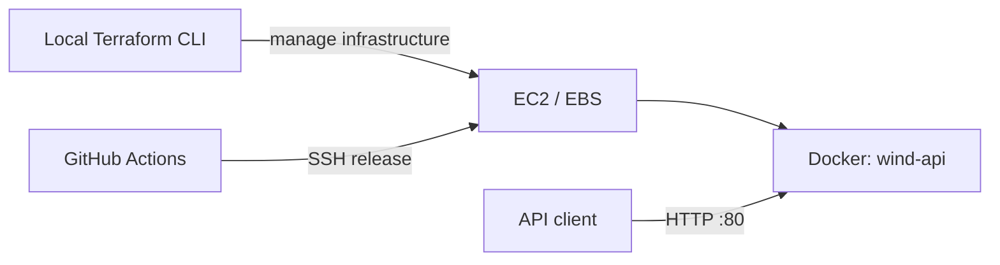

# Terraform: single-EC2 deployment

`master` uses one EC2 instance running the FastAPI Docker container. Terraform
manages the instance and can optionally create a dedicated security group.
The VPC, subnet and SSH key pair already exist. There is no EKS cluster, NAT
gateway, load balancer, Elastic IP, database, or paid Terraform service in this
configuration. Kubernetes/monitoring work stays on `feat/local-k8s-monitoring`.



Terraform creates infrastructure; the existing GitHub Actions workflow installs
Docker and deploys the application. This directory alone does not deploy the API.
Terraform `plan` / `apply` against AWS are not run in CI.

**Status:** the existing `wind` instance has been adopted with the import below
(`1 imported, 0 added, 0 changed, 0 destroyed`), and a follow-up `terraform plan`
reports `No changes`. The state that records this lives only in the local
`terraform.tfstate` (not committed), so a fresh clone must import again.

## 1. Install and configure

Use [Terraform CLI](https://developer.hashicorp.com/terraform/install) >= 1.7
(CI uses 1.13.5) and AWS CLI. Authenticate through an AWS profile or environment
credentials; do not put access keys in `.tf` or `.tfvars` files.

```bash
export AWS_PROFILE=your-profile
aws sts get-caller-identity
cd terraform
cp terraform.tfvars.example terraform.tfvars
terraform init
```

The region in the example is illustrative. Set the **actual region** and values
from your existing EC2 instance. The AMI is pinned intentionally: automatically
selecting the newest Ubuntu image would propose replacing a running instance.

## 2. Adopt the existing EC2 first (recommended)

Read the instance configuration in the AWS console or with these read-only
commands. Replace the example IDs and region:

```bash
aws ec2 describe-instances --region YOUR_REGION --instance-ids i-YOUR_INSTANCE \
  --query 'Reservations[].Instances[].{Id:InstanceId,AMI:ImageId,Type:InstanceType,Subnet:SubnetId,Key:KeyName,Groups:SecurityGroups,PublicIP:PublicIpAddress,Network:NetworkInterfaces,Disks:BlockDeviceMappings,Tags:Tags}'
aws ec2 describe-volumes --region YOUR_REGION --volume-ids vol-YOUR_ROOT_VOLUME \
  --query 'Volumes[].{Size:Size,Type:VolumeType,Encrypted:Encrypted,Iops:Iops,Throughput:Throughput}'
```

Fill `terraform.tfvars` with the instance's AMI, type, subnet, key pair, public-IP
setting, root volume size/type/DeleteOnTermination and user-defined tags.
Include **every attached security group** in `existing_security_group_ids` and
leave `create_security_group = false`. Existing security-group rules are then
outside Terraform's management and remain untouched. AWS-reserved `aws:` tags
should not be copied into `instance_tags`.

`existing_instance_id` is deliberately required. Setting it to the existing ID
enables the import block in `imports.tf`. A wrong/nonexistent ID fails import;
it does not silently create a replacement instance.

```bash
terraform fmt -check
terraform validate
terraform plan -out=adopt.tfplan
terraform show adopt.tfplan
```

For initial adoption, aim for **1 to import, 0 to add, 0 to change, 0 to destroy**.
If the plan proposes changes, adjust the configuration to match reality first.
Instances with additional settings (IAM instance profiles, custom metadata
options, volume tags, extra network interfaces, user data, etc.) may require
additional matching arguments in `main.tf`. Do not assume the example covers
every existing EC2 configuration.

After reviewing the actual plan, execute it yourself:

```bash
terraform apply adopt.tfplan
terraform plan # Subsequent plans should be no-op when configuration matches.
terraform output
```

The instance has `prevent_destroy = true`, so replacement/destruction plans are
blocked while this resource configuration remains present. This does not block
in-place updates or stop/start events (e.g. changing instance type), and is not
a substitute for plan review or backups. Do not remove the resource block to
work around this protection.

## 3. Optional: intentionally create a new instance

This is a **separate, billable deployment**, not required to adopt the existing
one. Set `existing_instance_id = null` explicitly, select a pinned Ubuntu AMI
matching the instance CPU architecture, and choose an existing public subnet
and key pair. Budget the instance RAM/disk for building this project's Python
dependencies; the example instance size is not a tested capacity guarantee.

To let Terraform create the security group, use:

```hcl
existing_security_group_ids = []
create_security_group       = true
ssh_allowed_cidrs           = ["YOUR_TRUSTED_PUBLIC_IP/32"]
```

The new group exposes HTTP port 80 and restricts SSH port 22 to those CIDRs.
Outbound IPv4 is permitted for packages, Docker images and external APIs.
The subnet must have an Internet Gateway route and the instance must have a
public IP for the current public HTTP/SSH deployment. Route tables are not
created or modified here.

**CI connectivity:** GitHub-hosted runners have changing outbound IP addresses.
Allowing only your laptop's IP will prevent the existing SSH deployment job
from connecting. Keep existing working groups during adoption; for a new group,
arrange an allowed runner egress address (for example, a self-hosted runner)
before attempting deployment. This module does not open SSH to the whole world
or automatically rewrite firewall rules.

After reviewing/applying a new-instance plan, configure repository Actions secrets:

- `VM_HOST`: `terraform output -raw public_ip`
- `VM_USER`: `ubuntu` for Ubuntu images
- `SSH_PRIVATE_KEY`: the private key corresponding to `key_name`, stored only in secrets

An application change pushed to `master` triggers the existing deployment job.
Terraform-only/documentation commits skip that job. GitHub Actions validates
Terraform on relevant pushes/PRs; it has no AWS credentials and never applies it.

## State, costs and scope

- Commit `.tf`, `.terraform.lock.hcl`, documentation and sanitized examples.
- Do not commit state, plans, real `.tfvars`, AWS credentials or SSH private keys.
  `.gitignore` excludes the standard state/plan/variable files and provider cache.
- The default backend stores state locally in this directory. Back it up securely
  and do not apply concurrently from different machines/copies of the state.
  Losing or ignoring state can lead to duplicate resources. For multi-person use,
  migrate deliberately to an S3 backend with locking; it is not provisioned here.
- Terraform Community CLI is free. EC2, EBS, public IPv4, traffic and any optional
  AWS services are charged under your account's applicable pricing/free tier.
  No new instance is needed just to import your existing one.
- Without an Elastic IP, the public IP can change after stopping/starting EC2;
  update `VM_HOST` and the demo URL when that happens. An EIP also has IPv4 costs.
- Stopping EC2 does not remove EBS storage charges. Terraform does not automatically
  stop instances, schedule downtime, enforce a budget, or change AWS billing.
- The API remains HTTP-only to match the existing deployment. This change does
  not add TLS or alter application behavior.

## Local / CI checks (no AWS credentials needed)

```bash
terraform fmt -check -recursive
terraform init -backend=false -input=false -lockfile=readonly
terraform validate
terraform test
```

The tests use a mock AWS provider and **plan-only** runs. They verify both
security-group modes and reject missing access configuration without touching AWS.
Real network reachability, permissions, AMI availability and instance adoption
still require a reviewed plan against your account.

References: [EC2 resource/import](https://registry.terraform.io/providers/hashicorp/aws/latest/docs/resources/instance),
[Terraform import](https://developer.hashicorp.com/terraform/language/import),
[Terraform editions](https://developer.hashicorp.com/terraform/intro/terraform-editions).
